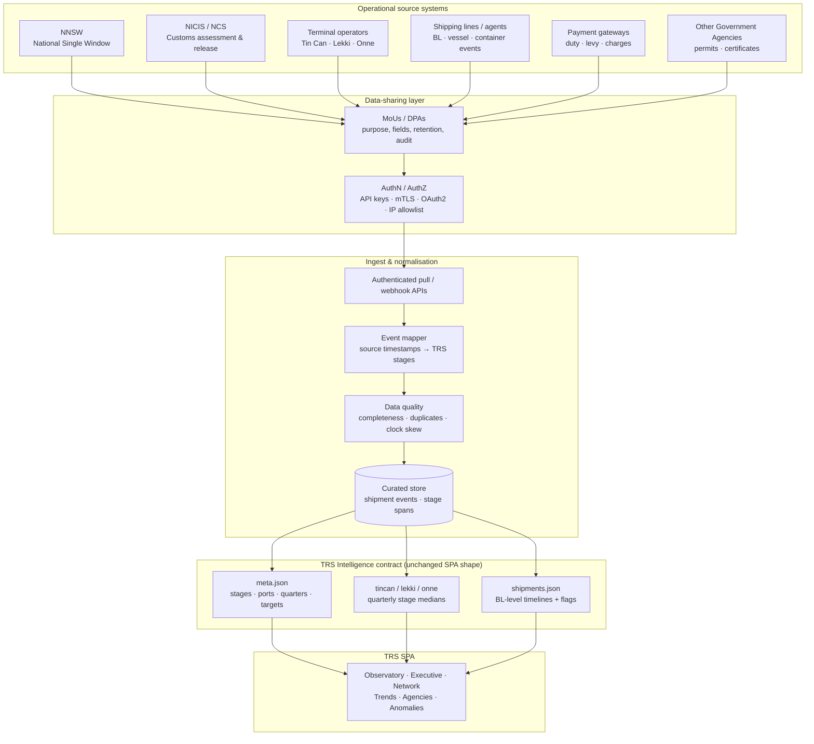

# A1 — Real Data Integration Architecture

**Maps to:** `docs/TODO.md` · P0 · A1  
**Purpose:** Replace synthetic port/shipment JSON with authenticated operational feeds while preserving the existing TRS SPA contract (`meta.json` + per-port quarters + shipments).  
**Governance template:** [`docs/MOU_DATA_SHARING_TEMPLATE.md`](./MOU_DATA_SHARING_TEMPLATE.md) — purpose-led MoU for each agency/operator, with Schedules A–F for current and future counterparties.

---

## Target data flow

---

## Stage event mapping (WCO TRS–aligned)

| TRS stage | Typical source systems | Example events |
|-----------|------------------------|----------------|
| **arrival** | Terminal, shipping line | Vessel berth, container discharge, gate-in |
| **permits** | NNSW, OGAs | Permit/certificate request & grant |
| **customs** | NICIS / NCS, payment | Assessment, duty paid, release order |
| **inspection** | NCS, OGAs, terminal | Exam start/end, scan result, joint inspection |
| **gateout** | Terminal | Gate-out, final exit |

Stage medians are derived from complete stage spans; overall release time is arrival → gate-out (medians need not sum).

---

## Current vs target

| Layer | Today (prototype) | Target (A1) |
|-------|-------------------|-------------|
| Port metrics | Static `tincan.json` / `lekki.json` / `onne.json` | Aggregated from curated event store by port × quarter |
| Shipments | Synthetic `shipments.json` | Live BL/container timelines from multi-source join |
| Meta | Hand-maintained `meta.json` | Generated + versioned from stage catalogue & targets |
| Access | Public static files | Authenticated feeds; SPA may use server-side proxy or signed URLs |
| Governance | N/A | MoUs with NNSW, NCS, terminals, lines, payment providers, OGAs — see `MOU_DATA_SHARING_TEMPLATE.md` |

---

## Integration sequence (recommended)

1. **Catalogue** — field inventory per source (timestamp, entity keys: BL, container, IMO, declaration ID).
2. **MoUs** — complete `MOU_DATA_SHARING_TEMPLATE.md` per counterparty (Schedules A–F); start with NNSW + NCS + one terminal.
3. **Ingest MVP** — read-only APIs or SFTP batch; map to five stages; DQ scorecard.
4. **Publish contract** — nightly (or hourly) rebuild of SPA JSON shape so the prototype UI keeps working.
5. **Expand** — remaining terminals, shipping lines, payment, OGAs via Schedule E accession; then live/near-real-time mode (TODO C1).

---

## Security & assurance notes

- Prefer **pull** from authority systems over trader-submitted timestamps for assurance independence (Workstream D).
- Log lineage: each stage span retains `source_system` + `event_id` for audit.
- Synthetic data remains available as a **demo profile** toggled off in production.
